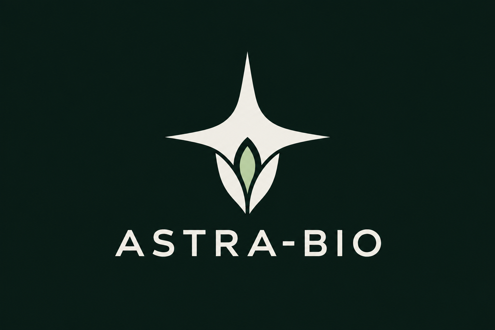
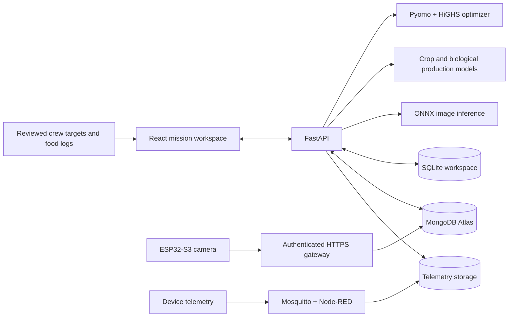

<div align="center">
  

# ASTRA-BIO

**Nutrition-aware biological production and resource planning for space habitats.**

Connect crew needs, food reserves, crop schedules and biological production in one mission workspace.

[Live demo](https://astra-bio.onrender.com/) · [API documentation](https://astra-bio-api.onrender.com/docs) · [Local setup](#quickstart) · [Documentation](#documentation)


</div>

## Overview

Long-duration missions must coordinate dietary needs with limited food, growing area, water and electricity. A crop that supplies a useful nutrient may still arrive too late or consume resources the mission cannot spare.

ASTRA-BIO is a research prototype that makes those tradeoffs visible. It combines mathematical optimization, crop reference data, experimental image models and hardware observations to help an operator compare plans. Its central workflow is:

**Crew needs → nutrient targets → production options → resource constraints → revised mission plan**

The broader vision is an adaptive biological ecosystem. The current product provides reviewed decision support: simulated output, reference estimates and physical measurements are identified separately.

## What you can do

| Workspace | Capabilities |
| --- | --- |
| **Mission overview** | Explore the saved mission day, crew roster, reserves, harvests and resource use; compare fixed and adaptive plans. |
| **Crew & nutrition** | Edit individual dietary targets, record food intake, view nutrient graphs and apply reviewed roster changes during a mission. New sample crew members receive distinct generated names. |
| **Crop recommendations** | Automatically compare options against the accepted whole-crew needs, mission day and unused resources. Show estimated nutrients, current crew intake, health-review alerts, stored-food support and reviewed microorganism projections; custom comparison is optional. |
| **Biological production** | Project literature-supported *Limnospira* and *Wolffia* output using reviewed capacity and resource inputs; compare disruption scenarios and inspect evidence for other candidate routes. |
| **What-if simulator** | Test water or power shortages, crop losses, crew changes and revised targets. Continue from remaining stocks and active crop batches while preserving completed history. |
| **Recovery planning** | Compare interventions, resource additions, reserve protection and harvest stress tests for a saved run. |
| **Leaf screening** | Run experimental image classification for tomato, potato and bell pepper; withhold unsupported or ambiguous results. |
| **Fruit checking** | Inspect tomato maturity or visible produce detections, bounding boxes, counts and model evidence. |
| **Live devices** | Review hardware and synthetic telemetry separately; inspect freshness, device status and stored ESP32 camera images. |
| **Workspace settings** | Save and restore configurations and plans, export data, inspect model provenance and apply reviewed crop calibration. |

Recommendations use the accepted mission inputs. Live sensor readings and camera observations do not automatically replan the mission or command equipment.

## Architecture



The frontend and API are deployed separately on Render. Mission configurations, nutrition snapshots and run history currently use SQLite; configured device observations and camera images use MongoDB Atlas. The local hardware gateway is a separate service, and its verified camera path does not establish cloud gateway deployment.

| Layer | Technology |
| --- | --- |
| Interface | React 19, Vite, Recharts, Lucide |
| API | Python, FastAPI, Uvicorn |
| Planning | Pyomo, HiGHS |
| Image inference | ONNX Runtime, NumPy, Pillow |
| Persistence | SQLite; MongoDB Atlas for configured device data |
| Hardware transport | HTTPS device gateway; optional Mosquitto, MQTT and Node-RED |
| Optional explanations | Local Ollama; Gemini for the documented plant-overview explanation flow |

The core planning workflow does not require a paid AI API.

## Models and evidence

ASTRA-BIO uses different methods for different tasks. The mission optimizer is a mathematical model; image classification is machine learning; food composition is reference data.

| Component | Method / data | Current evidence |
| --- | --- | --- |
| Mission planning | Pyomo/HiGHS constrained optimization | Models food allocations, planting, harvest timing and resource limits; compares fixed and adaptive policies. |
| Crop yield and duration | Ten terrestrial EDEN ISS / NASA RLSS crop profiles; endpoint calibration | Reference-based estimates. One held-out NASA lettuce trial had **46.94% yield error**, indicating limited transferability. |
| Lettuce age–mass curve | 540 plant/day observations with held-out plants | **5.72 g/plant MAE within one growing cycle**. Daily records are not independent growing experiments. |
| Food composition | Nine USDA food forms | Energy, protein and vitamin C calculations use reference composition, not measurements of our harvest. |
| Leaf classifier | MobileNetV3, classifier fine-tuning on PlantDoc | **636 train / 160 validation / 80 test images**, ten represented classes. Held-out accuracy: **41.25%**, versus **28.75%** for original weights. Fixed safeguards accepted only six test images, four correctly classified. |
| Fruit detectors | Four pretrained ONNX models | Local inference verified; no independent ASTRA-BIO fruit benchmark or fruit fine-tuning completed. |
| Microbial / aquatic production | Matched literature coefficients for *Limnospira indica* and an eight-week *Wolffia globosa* growth sequence | Reviewed production projections; commissioning and resource limits are charged. Research-only candidates do not receive invented yield estimates. |
| Environmental response fitting | Crop-cycle calibration workflow | Implemented, awaiting real repeated local crop cycles. |

See [model training and results](docs/ML_FINE_TUNING.md), [crop evidence](docs/CROP_MODEL_EVIDENCE.md), [nutrition evidence](docs/NUTRITION_EVIDENCE.md) and [biological production](docs/BIOLOGICAL_PRODUCTION.md).

### Interpretation boundaries

- The mission food planner tracks **energy, protein and vitamin C**. It does not establish complete dietary adequacy or turn blood results into clinical diagnoses.
- Default crew profiles, laboratory examples and mission scenarios are labeled sample data. They are not astronaut patient records.
- Biological production is a prospective comparison. Projected biomass is not automatically added to inventory or credited as consumed nutrition. Catalyst and engineered-organism routes remain evidence-only where matched yield/composition data are missing.
- Leaf and fruit images do not confirm pathogens, bacterial contamination or food safety. Model scores do not establish diagnostic certainty.
- Terrestrial datasets and local inference checks do not validate spaceflight performance. There is no demonstrated capsule replacement or autonomous closed-loop habitat control.

## Quickstart

The scripted setup targets **Windows PowerShell** with **Python 3.12**, [uv](https://docs.astral.sh/uv/) and **Node.js 24**.

```powershell
git clone https://github.com/Sanjay-AI-ML/astra-bio.git
cd astra-bio
.\setup.ps1
.\run.ps1
```

Open **http://127.0.0.1:8501**. Interactive API documentation is at **http://127.0.0.1:8501/docs**. Press `Ctrl+C` to stop the foreground application.

Setup installs locked dependencies, initializes synthetic telemetry and builds the frontend. Model binaries and private device configuration are not included in a fresh clone; model installation is described below.

### Frontend development

Keep the API running, then open another terminal:

```powershell
npm run dev --prefix frontend
```

Vite proxies `/api` requests to the local backend on port 8501. To rebuild the frontend served by FastAPI:

```powershell
npm run build --prefix frontend
```

Leave `VITE_API_ORIGIN` unset for local hosting. For separate frontend/API deployments, set it to the public backend origin without `/api`.

### Image model setup

To install the verified serving bundle used by the hosted app:

```powershell
.\.venv\Scripts\python.exe -m astra_bio.model_deployment
```

It includes base leaf weights, the evaluated fine-tuned candidate and four fruit detectors, with provenance and hash verification. Render installs it at API startup and selects the evaluated candidate on fresh installations; existing operator selections are preserved. `ASTRA_LEAF_MODEL` provides an explicit startup override. Low-confidence results remain uncertain.

For separate source downloads and local fruit export instead:

```powershell
.\scripts\setup-plant-model.ps1
.\scripts\setup-fruit-models.ps1 -Action Full
.\scripts\setup-fruit-models.ps1 -Action Status
```

These install the documented base/pretrained artifacts. Reproducing the fine-tuned leaf candidate requires the separate [fine-tuning workflow](docs/ML_FINE_TUNING.md). Downloads are pinned and verified; inference does not download weights on demand. Availability depends on the artifacts installed on each deployment.

## Hardware integration

The physically verified configuration is an **ESP32-S3 N16R8 with a GC2145 camera**. It captures RGB565, encodes JPEG and uploads through an authenticated HTTPS gateway to Atlas. Stored-image readback and duplicate handling were verified with the attached board.

Additional environmental sensors, their calibration and autonomous actuation remain unfinished. MQTT software tests used generated packets; they do not establish physical sensor performance.

For camera and Atlas setup, follow [ESP32 + MongoDB](docs/ESP32_MONGODB.md), [camera integration](docs/CAMERA_MONGODB.md) and the [camera firmware guide](integration/esp32-camera-mongodb/README.md). For MQTT, use the [hardware quickstart](docs/MQTT_QUICKSTART.md).

Keep database credentials, Wi-Fi passwords, device tokens and certificates out of Git and frontend environment variables.

## Deployment

**Frontend:** [astra-bio.onrender.com](https://astra-bio.onrender.com/)

**Backend:** [astra-bio-api.onrender.com](https://astra-bio-api.onrender.com/api/health)

The frontend is a Render Static Site built from `frontend`; the backend is a FastAPI web service. Configure the public API origin and explicit allowed hosts/origins using the [Render deployment guide](docs/RENDER_FRONTEND.md).

Local camera verification, cloud API connectivity and deployed model availability are separate checks. Saved planning history needs durable storage for reliable cloud persistence. The hosted prototype does not currently provide user accounts or workspace isolation; use demonstration data in the public workspace.

## Verification

```powershell
.\.venv\Scripts\python.exe -m pytest -q
npm test --prefix frontend -- --pool=threads --maxWorkers=1
npm run build --prefix frontend
```

Latest full regression run, **13 October 2026**:

| Check | Result |
| --- | --- |
| Backend | **624 passed**, 1 skipped; 13 subtests passed |
| Frontend | **188 passed** across 16 test files |
| Production frontend build | Passed |

Coverage includes resource conservation, harvest timing, mid-mission continuity, input validation, crop advice, biological-production boundaries, image contracts, snapshots, telemetry and deployment configuration. Passing software tests do not establish biological accuracy; most transport/storage tests use controlled fixtures, with physical camera verification documented separately.

## Repository guide

```text
astra_bio/    API, optimizer, production models and storage
frontend/     React application and UI tests
integration/  ESP32 firmware, MQTT and gateway configuration
scripts/      Model setup, calibration and reproducible workflows
data/         Reference data, reports and labeled sample missions
tests/        Backend regression tests
docs/         Evidence, architecture, setup and verification notes
```

## Documentation

- [Software overview](docs/PROJECT_OVERVIEW.md)
- [Crew roster and planning](docs/CREW_ROSTER_PLANNING.md)
- [Nutrient-aware crop advice](docs/NUTRIENT_CROP_ADVISOR.md)
- [Biological production and primary sources](docs/BIOLOGICAL_PRODUCTION.md)
- [Mid-mission changes](docs/ROLLING_MISSION_CHANGES.md) and [recovery planning](docs/RECOVERY_PLANNING.md)
- [Leaf model](docs/PLANT_VISION.md), [fruit monitoring](docs/FRUIT_MONITORING.md) and [ML validation](docs/ML_VALIDATION.md)
- [Crop training guide](docs/CROP_TRAINING.md)
- [Render deployment](docs/RENDER_FRONTEND.md)

## Roadmap

- Validate image screening and crop predictions against independent local tray cycles.
- Measure biological yield, nutrient composition and resource use in matched pilot batches.
- Extend durable cloud persistence to mission snapshots and nutrition logs.
- Integrate calibrated environmental sensors and reviewed sensor-to-planner inputs.
- Add authentication and workspace isolation before supporting private user data.
- Evaluate actuator control only after independent hardware safeguards and physical testing.

## License and acknowledgements

Repository code is distributed under [Apache License 2.0](LICENSE). Third-party datasets, model weights and reused projects retain their respective licenses and attribution requirements.

See [third-party notices](THIRD_PARTY_NOTICES.md) and [upstream sources](UPSTREAM_SOURCES.json) for provenance. The original starter attribution is preserved.
