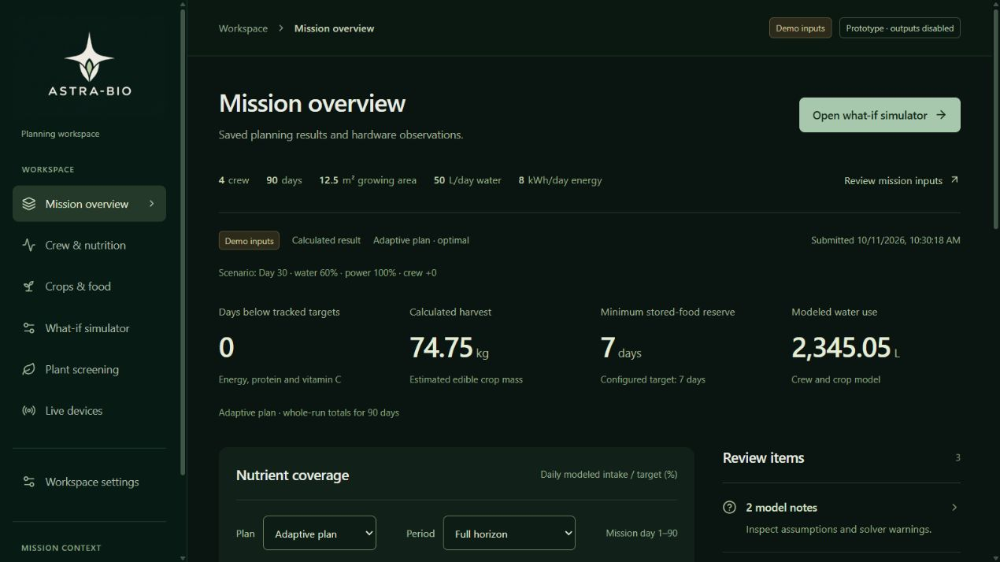
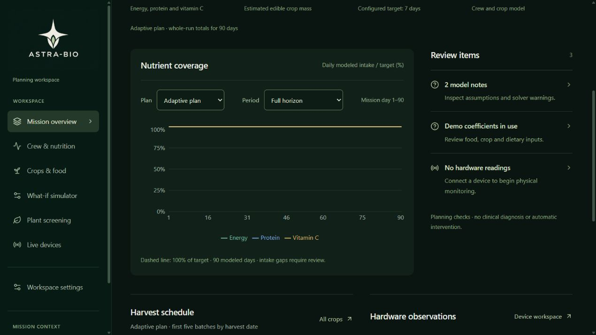

# Selected logo and open layout

Implemented locally on 11 October 2026 following the user's request to add their logo and make the frontend less boxy and less crowded. This revision supersedes the compact surfaces in [the previous operations revision](../operations/IMPLEMENTATION.md). Its professional workflow structure and [research rationale](../operations/RESEARCH.md) remain applicable.

## What changed

- The exact user-supplied Seed & Star PNG is now `frontend/src/assets/astra-bio-logo.png`. SHA-256: `b696c95a1e317ea7cd5ca1b38c57721e43e8522111f01b796c732187314a21e8`. It is imported once into the Vite asset graph and reused for the sidebar, loading screen and mobile header. The sidebar uses the full lockup; the header displays the emblem through a CSS viewport. No raster editing or regeneration occurred.
- Forest-black, ivory and sage replace the charcoal palette. The 240px sidebar has roomier navigation. Desktop content uses 36–44px vertical padding and 32–44px horizontal padding depending on width; mobile uses 18–20px side padding.
- Overview metrics are unboxed. Review items, harvests, hardware observations, settings and generic form sections use open backgrounds and fine separators. Only the overview chart retains a soft surface, with a 260px plot. Sections have 30–40px gaps.
- Headings, labels, table rows and controls have more room. Buttons have at least 44px height and fields are 44–46px high. Wide data tables retain internal scrolling. The overview stacks at widths of 1100px or less; mobile metrics use two columns.
- Shared chart colors follow the palette through CSS variables. Thin, subdued page/sidebar scrollbars replace the default bright tracks.

Planning, nutrition, model, persistence and MQTT behavior remains unchanged. Six primary workspaces and secondary Workspace settings remain. Synthetic inputs, hardware availability, prototype status and actuation limits remain visible.

## Verification

- **24 React interaction tests passed** with the logo integrated. They cover saved policy/period consistency, crop drill-down, grouped and legacy routes, explicit submission, retained drafts/logs, saving, drawer/skip-link behavior and missing/stale/error hardware observations.
- The final production Vite build passed. CSS parsed successfully and `git diff --check` passed.
- Actual browser review at **1280 × 720** confirmed the logo loads at its original 1536px source width, overview metrics are unboxed, and the review/detail sections have open backgrounds. The page has no horizontal overflow.
- Actual browser review at **390 × 844** checked the overview, nutrition assessment, mission inputs, crop schedules, what-if simulator, plant screening, live devices and saved workspace. Each page width stayed inside the viewport. Wide nutrition tables scroll internally, and mission inputs use full-width 44px-high fields. The drawer closes after navigation; Escape returns focus to the menu button and the closed drawer remains hidden.
- Switching the overview to Fixed baseline showed the saved baseline totals (60 gap days, 62.9kg harvest, 7-day minimum reserve, 2397.59L modeled water); switching back restored the adaptive plan. This was a saved-data UI check, not a new solve or biological validation. The local 90-day demonstration continues to use synthetic coefficients.
- No browser errors or warnings were reported during the responsive route checks. Temporary responsive viewport overrides were reset, and the updated mission overview was left open for the user.

## Actual product screenshots

[Phone overview](mobile.jpg) · [Phone mission inputs](mobile-form.jpg)

These are captures of the running local React/FastAPI product, not design mockups. No external deployment was performed during this revision.
