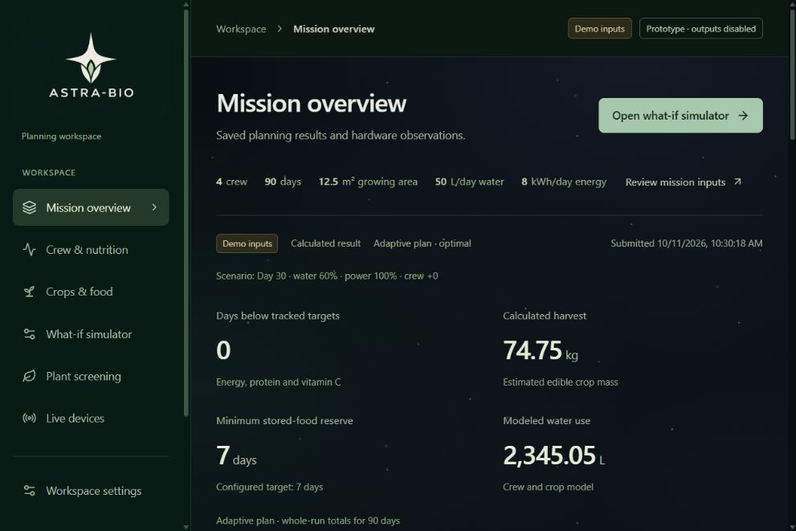

# Space background

Implemented on 11 October 2026 after the user asked for the dark area to look like space with glitters.

The dark canvas now uses a scattered CSS star field, faint blue/green/violet nebula gradients and five sparse twinkles with a 12-second opacity cycle. The two fixed decorative pseudo-elements sit behind the interface with `pointer-events: none`. Existing foreground surfaces preserve legibility. No image download, particle dependency or JavaScript animation loop is needed. Reduced-motion preferences retain static stars; print rules hide the decoration.

The production Vite build passed. Actual browser checks at the normal 1002 × 668 desktop viewport and a temporary 390 × 844 phone viewport confirmed no page overflow and that the mobile navigation still opens, closes with Escape and returns focus. The decorative layer's computed pointer behavior was `none`. This change affects CSS and the browser theme color only; the prior 24 passing interaction tests were not rerun for this cosmetic change.

[Phone capture](mobile.jpg)
